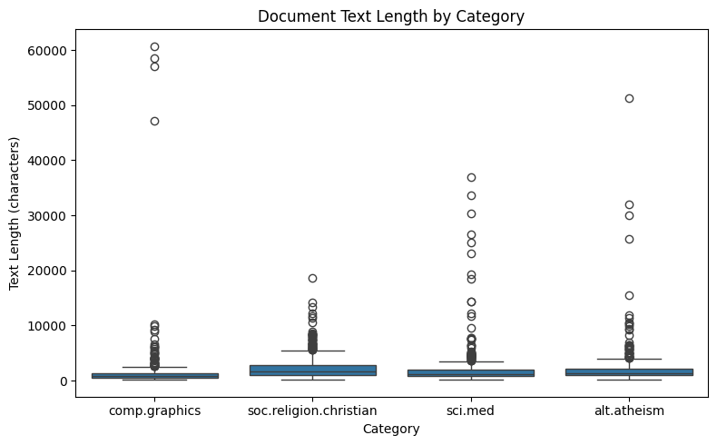
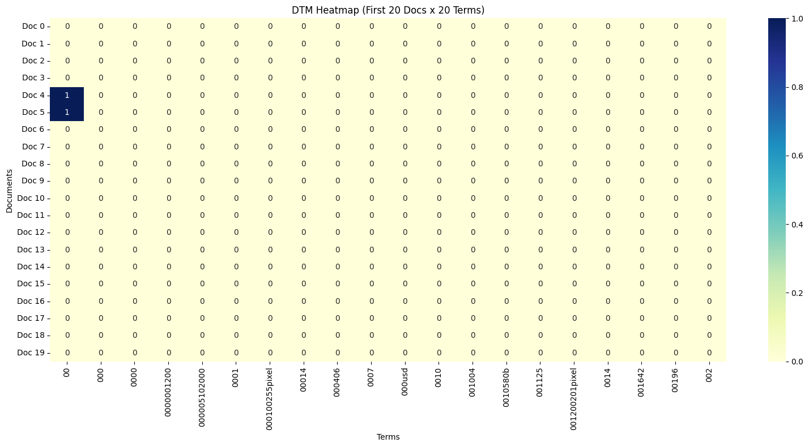
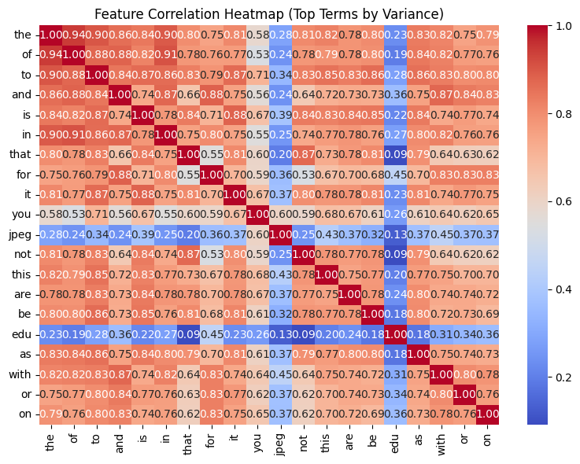
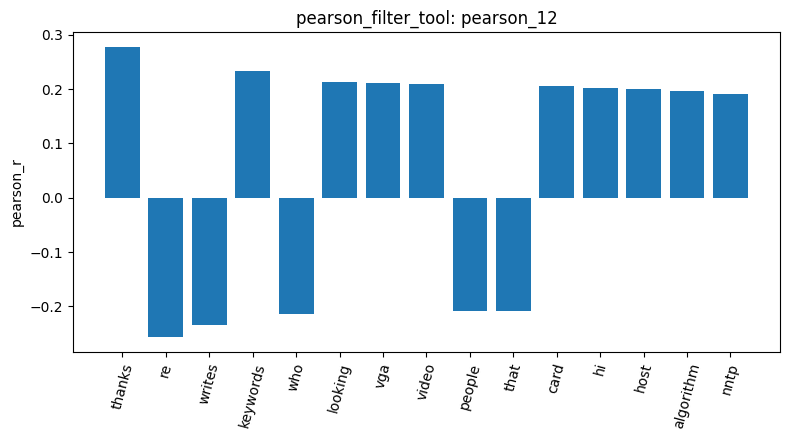
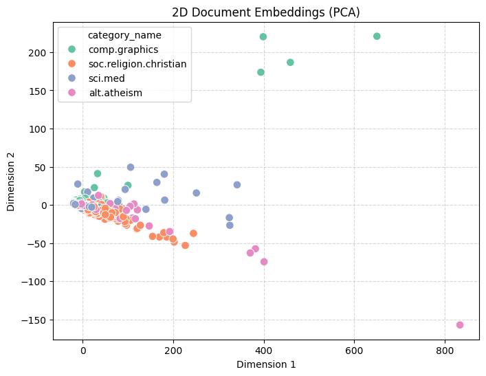
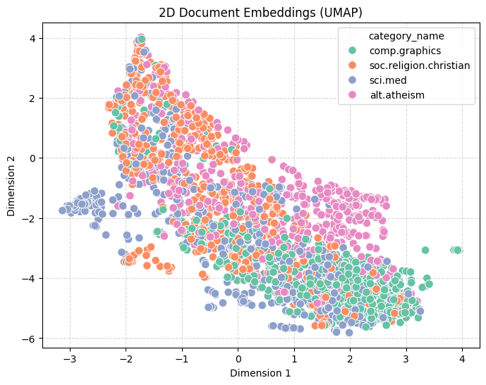

# Lab 1 agentic_pipeline_report

## Data Check

### 1. Load data

result ID: `load_dataset_1`

There are a total of 2257 documents loaded. 

- soc.religion.christian: 599
- sci.med: 594
- comp.graphics: 584
- alt.atheism: 480

alt.atheism has slightly less documents compared to others.

### 2. Inspect data
result ID: `inspect_data_2` 

Asked the agent to show the first 7 rows of the data. The chart shows 4 columns: index, text, category, and category_name.

### 3. Check for missing text in documents
result ID: `check_missing_3`

- Text column inspected: `text`
- Total rows: 2,257
- Missing count: 0
- Missing percentage: 0.0%

It shows that no text are missing.

### 4. Check for duplicates
result ID: `check_duplicates_4`

>Check if there are duplicate documents with check_duplicates_tool.

- Total rows before check: 2,257
- Duplicate count: 0
- Duplicate indices: []
- Drop requested: False
- Total rows after check: 2,257

result ID: `check_duplicates_5`

I tell the agent to check of a specific column `text`.

- Subset checked: ['text']
- Total rows before check: 2,257
- Duplicate count: 0
- Duplicate indices: []
- Drop requested: False
- Total rows after check: 2,257

### 5. Describe data

result ID: `describe_data_6`

Overall Statistics:
- Count: 2,257
- Mean: 1,992.96
- Std Dev: 3,547.66
- Min: 125.0
- 25%: 795.0
- 50% (Median): 1,235.0
- 75%: 2,059.0
- Max: 60,713.0

The statistic by category is also listed.

### 6. Subsample

Since the dataset size isn't large, I decide to not subsample it.

Here's a description on the `sample_data_tool` by the agent:
- Description: Subsamples n rows from session.dataframe, preserving the original row indices and updating session.dataframe in place.
- Parameters:
    - `n` (integer, required): The number of sample rows to draw.
    - `random_state` (integer or null, optional, default: None): Random seed for reproducible sampling.
- Returns: A summary dictionary containing:
`result_id`, `total_rows_before`, `sampled_rows`, `sample_indices`

## Document Term

### 7. Build DTM

result ID: `dtm_7`

- Number of documents: 2,257
- Number of terms: 35,788
- Non-zero elements: 365,886
- Total elements: 80,773,516
- Sparsity percentage: 99.547%

### Term frequency

result ID: `tf_8`

- Total terms analyzed: 35,788
- Returned terms count: 15 (Controlled by `top_n`)

Top 15 Terms & Frequencies:
- the: 29,825
- of: 17,660
- to: 17,222
- and: 13,017
- is: 12,343
- in: 11,226
- that: 10,723
- it: 8,447
- you: 6,157
- for: 5,962
- not: 5,285
- this: 5,063
- be: 4,898
- from: 4,877
- are: 4,769

These are all `stop_words`.

### 8. Heatmap

result ID: `dtm_heatmap_9`

- Documents sliced: First 20 documents (indices 0 through 19)
- Terms sliced: First 20 terms alphabetically

Most term counts are 0, matching the sparsity percentage in result of DTM.

## Feature Filtering

### 9. Variance Filter

result ID: `variance_10`

Sample Kept Terms (First 50 of 5,354):
'the', 'of', 'to', 'and', 'is', 'in', 'that', ... (the following terms were truncated by me so the report won't be too long)

Sample Removed Terms (First 50 of 30,434):
'anello', 'grabber', 'johnston', 'iraqis', 'bassili', 'deterrent', 'pox', ...

Only 15% percent of terms were kept. Terms like 'the', 'of' do not have meaning but are frequently used, resulting in higher variance. On the other hand, terms like 'anello' are not frequent, but can be related to the document.

### 10. Pearson Filter

result ID: `pearson_11`

- Target class: comp.graphics
- Threshold applied: 0.01
- Total terms analyzed: 35,788
- Terms kept (|r| ≥ 0.01): 34,359
- Terms removed (|r| < 0.01): 1,429

The result showed that little terms were removed. So I decide to try a stricter threshold.

result ID: `pearson_12`

- Target class: comp.graphics
- Threshold applied: 0.05
- Total terms analyzed: 35,788
- Terms kept (|r| ≥ 0.05): 3,418
- Terms removed (|r| < 0.05): 32,370

Sample Kept Terms (First 50 of 3,418):
'thanks', 're', 'writes', 'keywords', 'who', 'looking', 'vga', ...

Sample Removed Terms (First 50 of 32,370):
'wilson', 'telnet', 'conscious', 'whatsoever', 'revelations', 'portal', 'theological', ...

The kept terms now contain some related to the topic like 'graphics'. 

### 11. Spearman Filter

result ID: `spearman_13`

- Target class: comp.graphics
- Threshold applied: 0.05
- Total vocabulary terms in DTM: 35,788
- Terms analyzed (highest-variance filter): 1,000
- Terms kept (|r_s| ≥ 0.05): 704
- Terms removed (|r_s| < 0.05): 296

Sample Kept Terms (First 50 of 704):
'graphics', 'that', 'of', 'not', 'is', 'people', 'files', 'in', ...

Sample Removed Terms (First 50 of 296):
'saint', 'fallacy', 'protein', 'sinus', 'book', 'bad', 'dan', ...

### 12. Correlation heatmap

result ID: `feature_correlation_14`

### 13. Visualize bar chart

- Visualized Result ID: pearson_12
- Rows Plotted: 15 top terms

## Pattern Mining

### 14-1 variance, fpgrowth

result ID: `patterns_15`

- Target Category: comp.graphics
- Filtering Method: variance
- Algorithm: fpgrowth
- Minimum Support: 14
- Total Patterns Mined: 783

Top 30 Patterns (by Support):
- ['organization'] — Support: 560.0
- ['newsreader'] — Support: 58.0
- ['tin'] — Support: 56.0
- ['appreciated'] — Support: 55.0
- ['appreciated', 'organization'] — Support: 53.0
- ['newsreader', 'organization'] — Support: 53.0
- ['tin', 'newsreader'] — Support: 52.0
- ...

Little terms related to topic.

### 14-2 tfidf, fpgrowth

result ID: `patterns_16`

- Target Category: comp.graphics
- Filtering Method: tfidf
- Algorithm: fpgrowth
- Minimum Support: 80
- Total Patterns Mined: 999

Top 30 Patterns (by Support):
- ['lines'] — Support: 584.0
- ['subject'] — Support: 584.0
- ['lines', 'subject'] — Support: 584.0
- ['organization'] — Support: 560.0
- ['lines', 'organization'] — Support: 560.0
- ['subject', 'organization'] — Support: 560.0
- ['lines', 'subject', 'organization'] — Support: 560.0
- ...

With tfidf, still little or none of the terms related to topic.

### 14-3 tfidf, fpgrowth

result ID: `patterns_17`

- Target Category: sci.med
- Filtering Method: tfidf
- Algorithm: fpgrowth
- Minimum Support: 80
- Total Patterns Mined: 8,495

Top 30 Patterns (by Support):
- ['subject'] — Support: 594.0
- ['lines'] — Support: 585.0
- ['subject', 'lines'] — Support: 585.0
- ['organization'] — Support: 582.0
- ['organization', 'subject'] — Support: 582.0
- ['organization', 'lines'] — Support: 573.0
- ['subject', 'organization', 'lines'] — Support: 573.0

The result of little related words is the same of `sci.med`.

## Reduction

### 15. Reduce dimension

result ID: `reduce_dimensions_18`

Method: PCA (2 components)
- Total documents processed: 2,257
- Explained Variance Ratio:
    - Component 1: 65.94% (0.65937)
    - Component 2: 4.33% (0.04330)
    - Total Explained Variance: 70.27%

result ID: `reduce_dimensions_19`

- Method: UMAP (2D embedding)
- Total documents processed: 2,257

PCA is more concentrated, we cannot tell the difference of categories. UMAP has some seperated trend, but still not significant.

### 16. Binarize

result ID: `binarize_labels_20`

- Target Column Binarized: category_name
- Classes: ['alt.atheism', 'comp.graphics', 'sci.med', 'soc.religion.christian']
- Number of Samples: 2,257

Binarized Indicator Preview (First 5 samples):
- Sample 0 (comp.graphics): [0, 1, 0, 0]
- Sample 1 (comp.graphics): [0, 1, 0, 0]
- Sample 2 (soc.religion.christian): [0, 0, 0, 1]
- Sample 3 (soc.religion.christian): [0, 0, 0, 1]
- Sample 4 (soc.religion.christian): [0, 0, 0, 1]

## Similarity

### 17. Consine similarity

result ID: `cosine_similarity_21`

- Document Index 1: 0
- Document Index 2: 1
- Cosine Similarity Score: 0.3532

Both documents are from `comp.graphics`, but still have low consine similarity 0.3532.

result ID: `cosine_similarity_22`

- Document Index 1: 0
- Document Index 2: 2
- Cosine Similarity Score: 0.3399

Document index 2 comes from `soc.religion.christian`, they have slightly lower consine similarity. However, the difference is not significant.