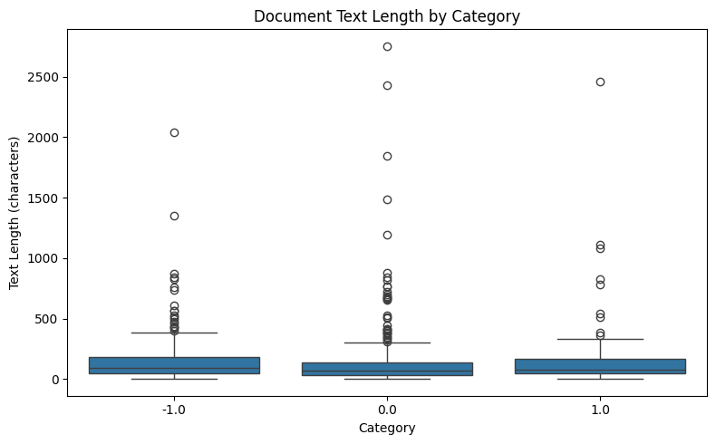
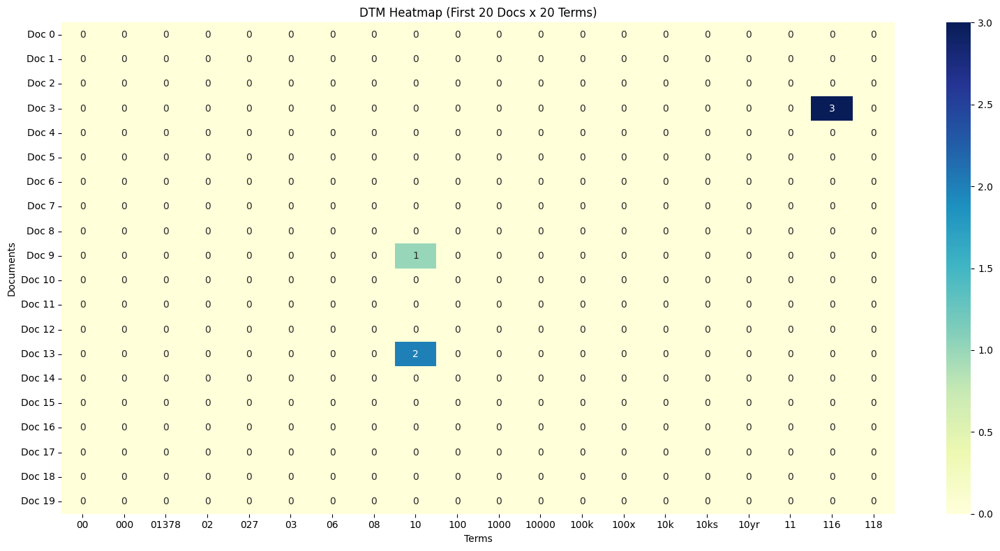
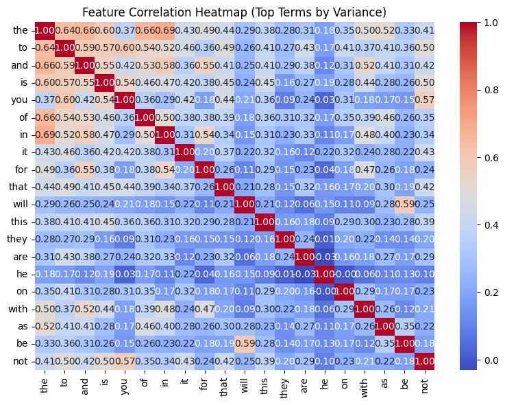
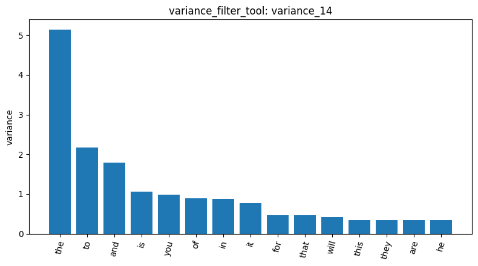
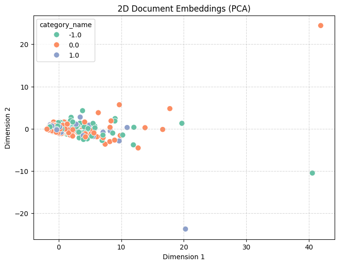

# Lab 1 homework_report

## Data Check

### 1. Load data

Dataset: newdataset/Reddit-stock-sentiment.csv

Result ID: `load_dataset_1`

- Total Documents: 847
- Text Column: text
- Label Column: label
- Counts per Category:
    - 0.0 (Neutral): 423
    - -1.0 (Negative): 315
    - 1.0 (Positive): 109

### 2. Inspect data

Result ID: `inspect_data_2` 

- Total Rows in Dataset: 847
- Rows Displayed: 10
- Columns: text, category_name, category

Parameters:  `n` = 10 and `max_text_len` = 150.

The result is correct. 

### 3. Check for missing text in documents

Result ID: `check_missing_3`

- Text Column Checked: text
- Total Rows: 847
- Missing Entries: 0
- Missing Percentage: 0 %

It shows that no text are missing.

### 4. Check for duplicates

Result ID: `check_duplicates_4`, `check_duplicates_5`, `check_duplicates_6` 

- Total Rows Before: 847
- Duplicate Count: 23 rows identified as duplicates across all scalar columns
- Duplicate Row Indices: [34, 42, 70, 105, 159, 160, 179, 192, 284, 349, 352, 387, 409, 421, 432, 438, 462, 473, 494, 520, 541, 583, 588, 595, 679, 680, 697, 712, 717, 783, 786, 802, 836, 844]
- Drop Requested: False
- Total Rows After: 847

The duplicate row indices include first occurence. Hence it has more than 23 elements.

Result ID: `check_duplicates_7`

Drop the duplicates:
- Total Rows Before: 847
- Total Rows After: 813
- Drop Requested / Dropped: True
- Duplicate Count: 23
- Removed Row Indices
All 34 indices associated with the duplicate sets were removed from the working DataFrame: [34, 42, 70, 105, 159, 160, 179, 192, 284, 349, 352, 387, 409, 421, 432, 438, 462, 473, 494, 520, 541, 583, 588, 595, 679, 680, 697, 712, 717, 783, 786, 802, 836, 844]

Note that the tool was designed to delete also the first occurence.

### 5. Describe data

Result ID: `describe_data_8`

Overall Statistics
- Count: 813 documents
- Mean Length: 148.31 characters
- Standard Deviation: 241.43
- Min Length: 1 character
- 25th Percentile: 39.0 characters
- Median (50%): 80.0 characters
- 75th Percentile: 165.0 characters
- Max Length: 2,753 characters
The statistic by category is also listed.

### 6. Subsample

Since the dataset size isn't large, I decide to not subsample it.

The following is the description of the tool by the agent.
- Description: Subsamples n rows from session.dataframe, keeping original indices and updating session.dataframe in place.
- Parameters:
    - `n` (integer, required): Number of sample rows to draw.
    - `random_state` (integer or None, default: None): Random seed for reproducible sampling.
- Returns: A summary dictionary containing result_id, total_rows_before, sampled_rows, and sample_indices.

## Document Term

### 7. Build DTM

Result ID: `dtm_9`

- Number of Documents (n_documents): 813
- Number of Terms (n_terms): 4,313
- Non-zero Elements (non_zero): 16,659
- Total Elements (total_elements): 3,506,469
- Sparsity Percentage (sparsity_pct): 99.52%

Result ID: `inspect_data_11`

Check if the index was reset when dropping duplicates. The result is 'No', just as how the tool was designed.

### 8. Term frequency

Result ID: `tf_12`

- Total Vocabulary Terms: 4,313

Top 20 Terms by Frequency:
- the: 874
- to: 554
- and: 471
- is: 386
- it: 338
- of: 299
- in: 278
- that: 220
- for: 209
- this: 209
- you: 195
- on: 167
- are: 151
- they: 148
- be: 132
- he: 132
- will: 127
- with: 124
- if: 119
- as: 111

These are all `stop_words`.

### 9. Heatmap

Result ID: `dtm_heatmap_13`

Slice Dimensions: First 20 documents ([0..19]) × First 20 terms in DTM vocabulary.

Most term counts are 0, matching the sparsity percentage in result of DTM.

## Feature Filtering

### 10. Variance Filter

Result ID: `variance_14`

- Threshold: 0.01
- Total Terms Analyzed: 4,313
- Terms Kept: 490
- Terms Removed: 3,823

Sample Kept Terms (First 50 of 490):
['the', 'to', 'and', 'is', 'you', 'of', 'in', ...] 

>Note: Included words like 'market', 'china', 'graphite' which are not stop words.

Sample Removed Terms (First 50 of 3,823):
['assets', 'april', 'note', 'uk', 'cut', 'removed', 'energy', ...]

### 11. Pearson Filter

Result ID: `pearson_15`
- Target Class: -1.0 (Negative sentiment)
- Threshold: 0.0
- Total Terms Analyzed: 4,313

Result ID: `pearson_16`

- Target Class: -1.0
- Threshold: 0.01
- Total Terms Analyzed: 4,313
- Terms Kept: 4,102
- Terms Removed: 211

Top 10 Terms Ranked by Pearson Correlation:
- he
- his
- will
- trump
- fuck
- china
- him
- economy
- trade
- until

### 12. Spearman Filter

Result ID: `spearman_17`

- Target Class: -1.0
- Threshold: 0.01
- Max Terms Analyzed: 1,000 (highest variance pre-filter)
- Total Terms: 4,313
- Terms Kept: 878
- Terms Removed: 122

Top 10 Terms Ranked by Spearman Rank Correlation:
- he
- will
- his
- trump
- fuck
- until
- the
- us
- him
- economy

The result is similar to pearson filter.

### 13. Correlation heatmap

Result ID: `feature_correlation_18`

Top 20 Terms by Variance Analyzed: ['the', 'to', 'and', 'is', 'you', 'of', 'in', 'it', 'for', 'that', 'will', 'this', 'they', 'are', 'he', 'on', 'with', 'as', 'be', 'not']

### 14. Visualize bar chart

- Visualized Result ID: variance_14
- Rows Plotted: Top 15 kept terms by variance

## Pattern Mining

### 15. variance, fpgrowth

Result ID: `patterns_19`

- Target Category: -1.0
- Filtering Method: variance
- Algorithm: fpgrowth
- Minimum Support (min_sup): 20
- Number of Patterns Found (n_patterns): 0

No frequent word under minimum support 20. Retry with minimum support 10.

Result ID: `patterns_20`

- Target Category: -1.0
- Filtering Method: variance
- Algorithm: fpgrowth
- Minimum Support (min_sup): 10
- Number of Patterns Found (n_patterns): 0

There are still no patterns found.

Result ID: `patterns_21`

- Target Category: -1.0
- Filtering Method: variance
- Algorithm: topk
- Number of Patterns Found (n_patterns): 10

Top 10 Patterns & Support Counts:

|Rank|Pattern|Support Count|
|---|---|---|  
1| ['buying']|	8.0
2|	['country']|	8.0
3|	['feel']|	8.0
4|	['know']|	8.0
5|	['support']|	8.0
6|	['trust']|	8.0
7|	['war']|	8.0
8|	['worse']|	8.0
9|	['didn']|	7.0
10|	['long']|	7.0

The result are all single words.

## Reduction

### 16. Reduce dimension

Result ID: `reduce_dimensions_22`

- Method: PCA (reduced to 2D)
- Total Documents Processed: 813
- Explained Variance Ratio:
    - Component 1: 26.70%
    - Component 2: 5.12%
    - Total Explained Variance: 31.82%

The documents are close and mostly lies on direction of Dimension 1.

### 17. Binarize

result ID: `binarize_labels_23`

- Target Column: category_name
- Classes Binarized: ['-1.0', '0.0', '1.0']
- Number of Samples: 813

Binarized Indicator Preview (First 5 Rows):

- Doc 0 (Category -1.0): [1, 0, 0]
- Doc 1 (Category 0.0): [0, 1, 0]
- Doc 2 (Category 0.0): [0, 1, 0]
- Doc 3 (Category 1.0): [0, 0, 1]
- Doc 4 (Category -1.0): [1, 0, 0]

## Similarity

### 18. Consine similarity

Result ID: `cosine_similarity_24`

- Document Index 1: 0 ("Calls on retards")
- Document Index 2: 1 ("Stunt as in like why did they even make a big deal about starting it in the first place? No company should ever talk about politics ever.")
- Cosine Similarity Score: 0.0

Result ID: `cosine_similarity_25`

- Document Index 1: 1 ("Stunt as in like why did they even make a big deal about starting it in the first place? No company should ever talk about politics ever.")
- Document Index 2: 2 ("Seeing lots of red in the ticker.")
- Cosine Similarity Score: 0.2004

Result ID: `cosine_similarity_26`

- Document Index 1: 0 ("Calls on retards")
- Document Index 2: 2 ("Seeing lots of red in the ticker.")
- Cosine Similarity Score: 0.0